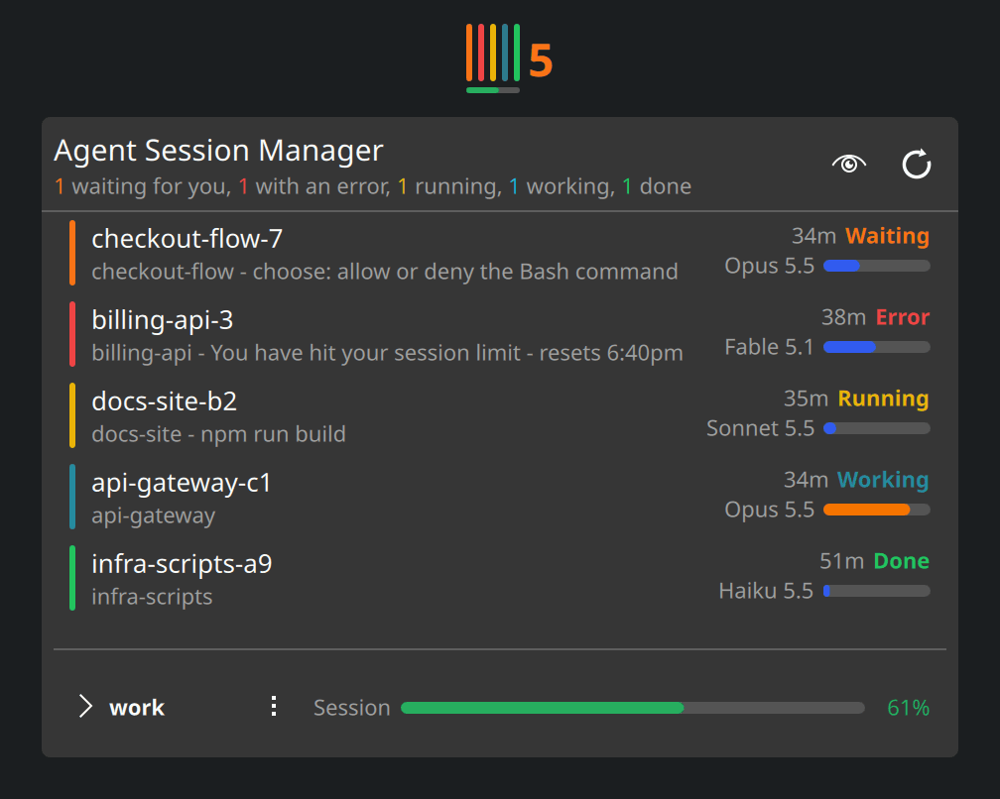
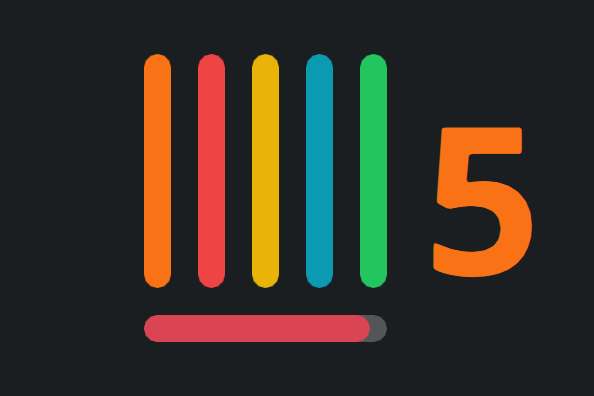
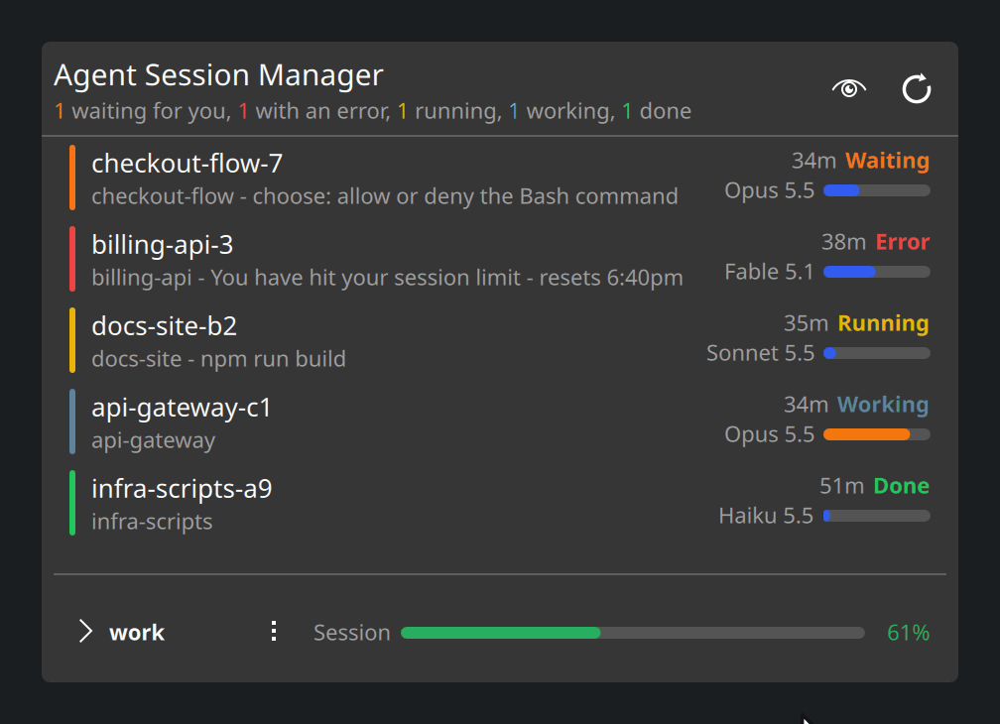
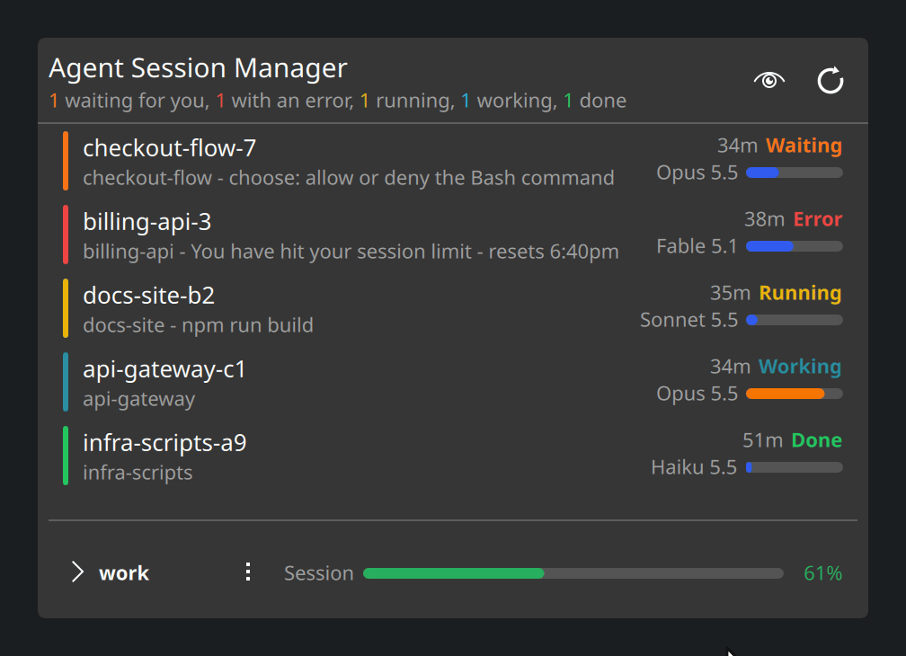
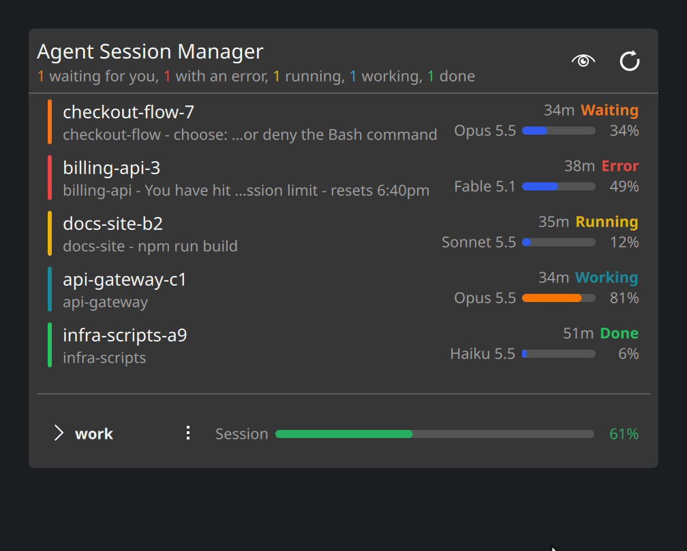

<div align="center">


<h1>Agent Session Manager</h1>

<p><b>See which of your Claude Code sessions needs you, from your Plasma panel.</b></p>

<p>


<a href="https://store.kde.org/p/2379987/"></a>
<a href="https://github.com/Pedroou/agent-session-manager/actions/workflows/tests.yml"></a>
<a href="LICENSE"></a>
</p>

<p>
<a href="#features">Features</a> •
<a href="#reading-the-panel">Reading the panel</a> •
<a href="#install">Install</a> •
<a href="#how-it-works">How it works</a>
</p>



</div>

Run several Claude Code or OMP sessions at once and the interesting question
stops being *what is the agent doing* and becomes **which one is waiting on me**.
This puts the answer in your panel: one bar per session, coloured by what that
session is doing, so a glance is enough.

## Features

- **Live status for every session** - waiting on you, stopped on an error,
  running a command, working, in a shell, or done.
- **Claude Code and [OMP](https://github.com/can1357/oh-my-pi)**, side by side
  in one list.
- **No setup.** It reads what each tool already writes: Claude Code's session
  registry, and the transcript every OMP session keeps open. No hooks, no
  wrappers, no config files to place.
- **Jump to any session.** Click its name and its terminal comes forward - on
  the right tab in Konsole, the right pane in tmux.
- **Model and context at a glance** - which model each session is on, and how
  full its context window is.
- **A popup with the details** - directory, git repository and branch, uptime,
  session id, pid. Click any value to copy it.
- **Your plan usage**, per Claude Code account, for whichever limit you care
  about.
- **Multiple account profiles.** Claude Code switches accounts with
  `CLAUDE_CONFIG_DIR`, which takes any path; OMP's named profiles are picked up
  on their own.
- **Native Plasma theming**, with every status colour overridable.

## Reading the panel

<div align="center">

</div>

<div align="center">

| | State | Meaning |
|:--:|---|---|
|  | **Error** | its last turn failed, and the message is shown |
|  | **Waiting** | blocked on you, and it says what for |
|  | **Running** | a command or script is executing, and it says which |
|  | **Working** | Claude is generating |
|  | **Shell** | the terminal has been handed to a shell |
|  | **Done** | finished, waiting for your next prompt |

</div>

The number beside the bars is the session count, coloured by whichever state has
the most sessions - unless something is waiting on you, which always takes
priority. Underneath sits a thin bar for your plan usage, which turns amber
and then red as the limit fills.

## The popup

Click the widget for the full list, sorted so whatever is blocked sits at the
top. Click a session's name to go to it: the window it runs in comes forward,
on the right Konsole tab or tmux pane. Click anywhere else on the row to open
its details, and any value to copy it. Right-click copies the whole row, or the
command to drop back into that session.

Under each state sits the model the session is on and a bar for how full its
context window is, amber past three quarters and red past 90%. Hover it for the
token count.

<div align="center">

<p><sub>Every session worst first, one of them opened up, and a value copied out of it</sub></p>
</div>

Hovering a row gives you a pencil, to rename it to something you will recognise,
and a close button that asks before ending the session. The eye in the header
blanks every name and path for screen-sharing.

<div align="center">

<p><sub>The name is the link to the session; rename one, or end one - the second click is the confirmation</sub></p>
</div>

## Plan usage

At the bottom, how much of your plan each account has used. Pick the limit each
one tracks - session, weekly, or a model-scoped one - behind the dots on its
row, and the panel bar follows whichever you chose. Accounts you have not picked
for show the default, which is the session limit until you change it on the
Popup page. Until you pick an account, the footer and the panel bar follow the
first one that has a reading. Opened up, the footer lists accounts most recently
shown first: the one on screen at the top, the one before it second, and so on.

OMP's Claude logins get a row each, named the way their sessions are - **OMP**,
or **OMP <profile>** for a named profile. The numbers come from `omp usage`,
which OMP answers itself, so the widget never reads OMP's logins: a Claude
account you only ever use through OMP has a usage bar without Claude Code being
signed in at all.

<div align="center">

<p><sub>Both accounts at once, green to amber to red as the limit fills</sub></p>
</div>

## Install

Requires **Plasma 6**, `bash`, `jq`, `curl` and `timeout`. OMP's usage rows also
need a systemd user session, which is what keeps `omp` to its memory cap.

**From the KDE Store.** Right-click your panel → **Add or Manage Widgets…** →
**Get New Widgets** → **Download New Plasma Widgets**, search **Agent Session
Manager** and install it. The listing is at
[store.kde.org/p/2379987](https://store.kde.org/p/2379987/).

**From source.** `install.sh` checks for every requirement, plus
`kpackagetool6`, before it installs:

```sh
git clone https://github.com/Pedroou/agent-session-manager
cd agent-session-manager
./install.sh
```

Either way, add it with right-click on the panel → **Add or Manage Widgets…** →
search **Agent Session Manager**.

Upgrading while the widget is already on the panel needs a shell restart, since
Plasma caches applet QML. `install.sh` prints the command.

## Configuration

Right-click the widget → **Configure…**. Five pages, split by where each setting
takes effect:

- **General** - how often to check, the needs-attention highlight, the privacy
  toggle, and whether to show OMP sessions and OMP's plan usage. Plus one button
  that resets every page.
- **Panel** - the session count and its size, and the usage bar: whether to show
  it, how used the limit must be before it appears, and whether it colours by
  severity.
- **Popup** - how many sessions it shows before scrolling, which limit plan
  usage shows by default, which rows an expanded session has, and where the
  branch goes.
- **Accounts** - which config directories to watch.
- **Colours** - all six status colours.

### Accounts

On first run the widget looks once for accounts and puts what it finds in the
list, so there is nothing to set up for the common case and the list always says
what is actually being read.

After that it is the **Accounts** page. Point **Search** at a directory and it
looks one level down for anything Claude Code has written to - your home
directory, by default, since `CLAUDE_CONFIG_DIR` is usually pointed at a sibling
of `~/.claude`.

What it finds is listed but not switched on: results are marked **found** and sit
there until you press **+**. A search is a question, not an instruction, and
wiring up every directory it happens to turn up is not an answer you asked for.
Press **-** on a result to drop it instead. Naming a directory yourself *is* an
instruction, so that one goes straight in.

Added accounts can be renamed to something you will recognise, switched off
without being forgotten, or removed.

After that first look, searching only ever happens because you asked. An account
you remove has to stay removed, and it cannot if something re-runs the search
behind you - so nothing does, and an empty list means exactly that: nothing is
watched.

## How it works

Claude Code already publishes most of this. Every running session maintains a
record at `<config-dir>/sessions/<pid>.json` and rewrites it as its state
changes, so the widget is a reader of a file the tool already writes.

Two of the six states are **not** in that record and are worked out here:

**Running** comes from the process tree. Claude Code executes every Bash tool
call as a direct child shell of its own process, while its long-lived children
are MCP servers, which are not shells - so the two never get confused, and the
command itself is recoverable from the child's `cmdline`.

**Error** comes from the transcript, whose last assistant entry carries
`isApiErrorMessage` and a message worth reading. The transcript lags live state
badly, which is exactly why it is trusted only for a session that has already
stopped.

Records outlive sessions that were killed rather than closed, so each is checked
the way Claude Code checks its own: the process must exist **and** its start time
in `/proc` must match the record, which rules out a recycled pid.

Every account is read the same way, and an account is only ever a directory:
`CLAUDE_CONFIG_DIR` is what Claude Code itself uses, so a session's "reopen"
command is that variable and nothing else - except for `~/.claude`, the one
value it must never be set to.

**OMP** keeps no registry, so its sessions are found the other way round.
Every `omp` process in `/proc` is a session (bar its own `__omp_worker`
helpers), and each holds its transcript open while it writes - so the process's
fd table says which session it is, and the tail of that transcript says what it
is doing:

- a prompt or a tool result last means **Working**;
- a `bash` or `eval` call that has started and has no result yet is
  **Running**, with the command;
- an `ask` call in the same position is **Waiting**, with the question;
- a turn that ended in an error is **Error**, with the message; one that
  finished, or was interrupted, is **Done**.

OMP writes a marker the moment each tool starts, so unlike Claude Code's
transcript this one is live. A session that has not written anything yet holds
no transcript open; it is found through the breadcrumb OMP leaves for its
terminal, the same file `omp --continue` reads. The resume command is
`omp --resume <id>`, with `--profile` for a named profile.

**Show OMP sessions**, on the General page, switches all of this off: no
process scan, no reads, nothing run. On, its cost has fixed ceilings: at most 32
sessions, and of each transcript at most 4 KiB of its first line and 128 KiB of
its end. If a command cannot start, for want of memory or anything else, that
one refresh goes without its OMP rows; nothing is retried and nothing is
written. Every run of the collector is also held to 1 GiB of address space and
30 CPU-seconds per process, and stopped after 20 seconds, and the widget never
starts a run while the same one is still going.

Ending a session from the popup checks first that the process is still the one
that was listed - its start time in `/proc` has to match - so a pid reused by
something else since is never signalled.

OMP's plan usage is asked of OMP: `omp usage --json --provider anthropic`, once
for `~/.omp/agent` and once per named profile, each time plan usage refreshes.
`omp` is a 200 MB runtime, so it only ever runs inside a transient systemd scope
that the kernel holds to 512 MB of memory, no swap and 64 tasks - past that it
alone is killed, inside its scope - and it is stopped after 15 seconds. Without
a systemd user session to enforce that it is not run at all, and the row says
so. A failed run keeps the last reading on screen, as a failed Claude Code fetch
does.

Everything with a decision in it lives in two bash collectors, the two jq
programs that read OMP, and two Qt-free JavaScript files - all testable without
a running Plasma shell. The collector suite is itself written in fish, so
running it needs fish; the widget does not:

```fish
fish --no-config test/test-collectors.fish   # 140 assertions
node --test test/sessions.test.js            # 39
node --test test/usage.test.js               # 29
```

The collector suite builds a throwaway `$HOME`, a throwaway `/proc` **and** throwaway
transcripts, then runs the real collectors against them - so a recycled pid, a
half-written record, an MCP child that is not a command, a command starting
with `--` that `jq` would otherwise eat as a flag, and an OMP helper process
that is not a session are covered rather than assumed.

[`docs/design.md`](docs/design.md) is the full write-up, and
[`docs/limitations.md`](docs/limitations.md) is honest about what it cannot do.

## Privacy

**What leaves your machine.** Only the plan-usage bar. It asks Anthropic for your
limits using the login Claude Code already stores; the token goes to `curl`
through stdin rather than argv, so it never appears in the process list, and it
never reaches the widget's own code. For OMP's logins it runs `omp usage`, and
OMP makes the same request with its own credentials. Nothing else leaves the
machine, and the widget writes nothing to your Claude Code or OMP config
(`omp usage` keeps its own cache and refreshes its own tokens, as it does
whenever you run it). There is no server, no telemetry and nothing to sign up
for.

**About that endpoint.** It is the one Claude Code's own `/usage` view uses, and
it is undocumented. Anthropic's terms describe the OAuth login as being for
Claude Code and other Anthropic applications, and point developers building on
Claude at an API key instead. So this reads your own token on your own machine
for your own numbers, but it is not a use Anthropic has blessed, and the honest
expectation is that it stops working one day rather than that it keeps working
forever. See [Anthropic's legal and compliance
page](https://code.claude.com/docs/en/legal-and-compliance).

It is on by default because it is half of what the widget is for, and it is one
checkbox to turn off: **Configure… → Popup → Plan usage for each profile**, plus
**Panel → Plan Usage Bar** for the strip under the bars. OMP's rows have their
own: **General → Show plan usage for OMP's Claude logins**. The session list is
unaffected either way - that half reads nothing but your own filesystem.

## Licence

MIT - see [LICENSE](LICENSE).

<sub>Unofficial, and not affiliated with or endorsed by Anthropic. Claude and
Claude Code are trademarks of Anthropic, PBC.</sub>
